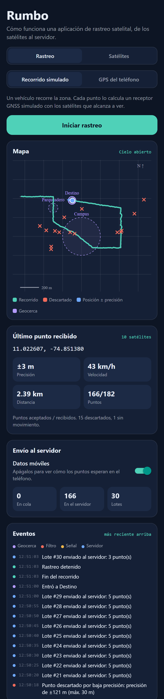
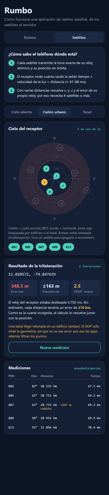

# Rumbo

**Cómo funcionan las aplicaciones de rastreo satelital**, de los satélites al servidor, en una app Expo.

Programación Móvil · Universidad del Norte · Grupo 1
**Integrantes:** Daniel Cruzado · Hernán Mundell

- **Diapositivas:** [`presentacion/Rastreo-satelital.pptx`](presentacion/Rastreo-satelital.pptx)
- **Video de la exposición:** _(pendiente)_

<p>
  
  
</p>

## Ejecutar

```bash
npm install
npx expo start
```

Abre la app con Expo Go (escanea el QR) o presiona `w` para verla en el navegador.

## Verificar

```bash
npm run typecheck
npm test
```

## Flujo

**Pestaña Satélites: cómo el teléfono calcula su posición**

1. Elige el entorno: **Cielo abierto**, **Cañón urbano** o **Túnel**.
2. Mira el cielo desde el receptor y apaga o enciende satélites tocándolos.
3. Lee el resultado de la trilateración: posición, error real, precisión estimada, HDOP y el desfase del reloj.
4. **Nueva medición** repite el cálculo con otro ruido.

**Pestaña Rastreo: lo que hace una app de rastreo con esas posiciones**

1. Elige **Recorrido simulado** o **GPS del teléfono**.
2. **Iniciar rastreo**: el mapa dibuja el recorrido, los puntos descartados y las geocercas.
3. Apaga **Datos móviles**: los puntos se guardan en la cola del teléfono. Al encenderlos se envían al servidor.
4. Revisa los eventos: entradas y salidas de geocercas, puntos filtrados, pérdida de señal y lotes enviados.

## Qué muestra

- **Pseudodistancias.** Cada satélite transmite su hora y su posición. El receptor mide el tiempo de viaje de la señal (≈ 67–86 ms) y lo multiplica por la velocidad de la luz.
- **Trilateración con 4 incógnitas.** Se resuelven x, y, z y el error del reloj del receptor por mínimos cuadrados (Gauss-Newton). Por eso se necesitan al menos 4 satélites. Un desfase de 0,5 ms equivale a 150 km.
- **DOP (dilución de la precisión).** Satélites repartidos por el cielo dan HDOP bajo. En un cañón urbano solo quedan los satélites altos y la precisión empeora.
- **Multitrayecto.** Entre edificios, una señal rebotada recorre más camino. El DOP no detecta ese error, y por eso existe el filtro.
- **Filtro de puntos.** Descarta puntos con precisión mayor a 30 m, saltos imposibles (más de 200 km/h) y puntos sin movimiento.
- **Geocercas.** Generan avisos al entrar o salir de una zona, con margen para evitar avisos repetidos en el borde.
- **Guardar y reenviar.** Los puntos se envían al servidor por lotes (ahorro de batería y datos). Sin cobertura se acumulan y no se pierde ninguno.
- **GPS real.** Con `expo-location` el sistema operativo entrega la posición fusionada (GNSS + Wi-Fi + red celular) y su precisión.

En modo simulado, cada punto del recorrido lo calcula el mismo algoritmo de trilateración a partir de una constelación GPS simulada sobre la Universidad del Norte. No hay servidores ni se envían datos fuera del teléfono.

## Arquitectura

Clean Architecture en `src/`:

- `domain/` — reglas sin Expo: geodesia (`geo/`), GNSS (`gnss/`: coordenadas ECEF, constelación, trilateración, DOP), rastreo (`tracking/`: filtro, geocercas, cola, estadísticas), puertos y el caso de uso `TrackingSession`
- `data/` — proveedor de ubicación real (`expo-location`), receptor GNSS simulado con su ruta, y servidor en memoria
- `presentation/` — hooks, componentes (mapa y cielo en SVG) y pantallas
- `di/` — composition root
- `app/` — rutas Expo Router

```
Satélites ──► Receptor GNSS ──► Filtro ──► Recorrido ──► Geocercas
 (tiempo)     (trilateración)    │                         │
                                 ▼                         ▼
                           descartados              Cola ──► Servidor
```

## Estructura

```
src/
├── app/                      # _layout.tsx, index.tsx (pestañas)
├── di/container.ts
├── domain/
│   ├── geo/                  # haversine, rumbo, proyección local
│   ├── gnss/                 # coordinates, constellation, positioning, receiver
│   ├── tracking/             # fixFilter, geofence, uploadQueue, trackStats
│   ├── repositories/         # LocationProvider, TrackingServer (puertos)
│   └── usecases/TrackingSession.ts
├── data/
│   ├── providers/            # ExpoLocationProvider, SimulatedGnssProvider, simulatedRoute
│   └── repositories/InMemoryTrackingServer.ts
└── presentation/             # components, hooks, screens, theme
```

## Referencias

- GPS.gov — [How GPS works](https://www.gps.gov/systems/gps/performance/accuracy/)
- ESA Navipedia — [GNSS basic concepts](https://gssc.esa.int/navipedia/)
- Expo — [`expo-location`](https://docs.expo.dev/versions/latest/sdk/location/)
- Android Developers — [Fused Location Provider](https://developers.google.com/location-context/fused-location-provider)
